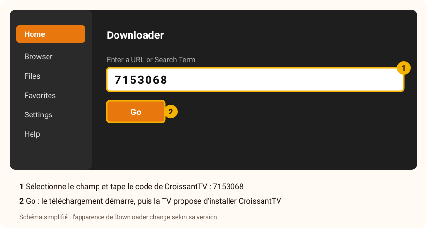

# Installer CroissantTV sur Android TV, Google TV ou Fire TV

[← Retour à l'accueil](../README.md) · [Questions fréquentes](../FAQ.md)

Ce guide vaut pour les **TV et boîtiers Android TV ou Google TV** (Sony, Philips, TCL, Hisense, Xiaomi,
Nokia Streaming Box, Nvidia Shield, Chromecast avec Google TV, Google TV Streamer…) et pour les
**Fire TV d'Amazon** (Fire TV Stick, Fire TV Cube).

**Compte 10 minutes.** Tout se fait sur la TV, à la télécommande : **pas besoin d'ordinateur.**

> [!WARNING]
> **Fire TV : les modèles récents sous « Vega OS » ne peuvent pas installer CroissantTV.** C'est le cas du
> **Fire TV Stick 4K Select** et des derniers **Fire TV Stick HD**. Pour savoir ce qu'a ta clé :
> **Paramètres › Ma Fire TV › À propos** : si tu lis **Fire OS**, c'est bon ; si tu lis **Vega OS**, Amazon
> n'autorise plus que les applications de son magasin.

## Le principe

CroissantTV n'est pas encore dans le Play Store ni dans l'Appstore Amazon. On l'installe avec **Downloader**,
une application gratuite et très connue qui télécharge un fichier d'application (un **APK**) et le fait
installer par la TV. Il faut juste, une fois, **autoriser Downloader à installer des applications**.

---

## Étape 1 — Installer Downloader

- **Android TV et Google TV :** ouvre le **Google Play Store** de la TV, cherche **Downloader** et installe celui de l'éditeur **AFTVnews** (icône orange).
- **Fire TV :** dans **Rechercher** (la loupe), tape **Downloader** et installe celui d'**AFTVnews**.

## Étape 2 — Autoriser Downloader à installer des applications

Choisis la partie qui correspond à ton appareil.

### Google TV (Chromecast avec Google TV, Google TV Streamer, TV Sony, TCL, Hisense récentes…)

1. **Paramètres › Système › À propos.**
2. Descends sur **Build du système d'exploitation Android TV** (ou *Android TV OS build*) et appuie **7 fois de suite** sur <kbd>OK</kbd>. Un message annonce que tu es développeur.
3. Reviens en arrière, puis **Paramètres › Applications › Sécurité et restrictions › Sources inconnues.**
4. Active **Downloader**.

### Android TV (TV Philips, Sony plus anciennes, boîtiers Xiaomi, Nokia, Nvidia Shield…)

1. **Paramètres › Préférences de l'appareil › Sécurité et restrictions › Sources inconnues** (selon les marques, ce menu est parfois dans **Applications**).
2. Active **Downloader**.

### Fire TV (Fire OS)

1. **Paramètres › Ma Fire TV.**
2. Si tu vois **Options pour les développeurs**, passe au point 3. Sinon : va dans **À propos**, sélectionne le **nom de ton appareil** (par exemple *Fire TV Stick 4K Max*) et appuie **7 fois** sur <kbd>OK</kbd>. Un message annonce que tu es développeur ; reviens en arrière.
3. **Options pour les développeurs › Installer des applis inconnues** (ou *Applications de sources inconnues*).
4. Active **Downloader**.

> [!NOTE]
> Les noms exacts varient un peu selon les marques et les versions. Si tu ne trouves pas ces menus, passe
> directement à l'étape 3 : au moment d'installer, la TV te proposera elle-même d'ouvrir le bon réglage
> (bouton **Paramètres**, puis **Autoriser cette source**, puis retour).

## Étape 3 — Télécharger et installer CroissantTV

1. Ouvre **Downloader**. S'il demande l'accès à tes fichiers ou à tes médias, réponds **Autoriser**.
2. Sélectionne le champ d'adresse (*Enter a URL or Search Term*) et tape le code de CroissantTV :

   ```
   7153068
   ```

3. Valide avec **Go**. Le téléchargement démarre (une douzaine de mégaoctets).
4. La TV propose d'installer **CroissantTV** : choisis **Installer**.
5. À la fin, choisis **Ouvrir**, ou retrouve CroissantTV dans la liste de tes applications.
6. Downloader propose ensuite de **supprimer le fichier téléchargé** : accepte (*Delete*), il ne sert plus à rien.



**Le code ne marche pas ?** Tape à la place l'adresse complète, tout attaché, sans espace (les majuscules et
les tirets comptent) :

```
github.com/thomasjanet60-spec/CroissantTV-beta/releases/latest/download/CroissantTV.apk
```

> [!TIP]
> Pour taper une adresse plus facilement, ton téléphone peut servir de clavier : l'application **Google TV**
> (Android TV et Google TV) ou l'application **Amazon Fire TV** (Fire TV) offrent une télécommande avec un
> vrai clavier.

Au premier lancement, CroissantTV te guide : il te demande ton abonnement IPTV, ou te propose la **démo** pour découvrir l'application sans abonnement. Il te propose ensuite de régler l'affichage, la langue et le démarrage en quelques questions : voir **[Premiers pas](Premiers-pas.md)**.

---

## Autre méthode : avec une clé USB

Pour les TV et boîtiers qui ont un port USB (pas les clés Fire TV). Pratique si Downloader pose problème.

1. Sur un ordinateur, télécharge le **[kit Android](https://github.com/thomasjanet60-spec/CroissantTV-beta/releases/latest/download/CroissantTV-Kit-Android.zip)** et extrais-le (clic droit, **Extraire tout…**), ou télécharge seulement **[CroissantTV.apk](https://github.com/thomasjanet60-spec/CroissantTV-beta/releases/latest/download/CroissantTV.apk)**.
2. Copie le fichier **CroissantTV.apk** sur une clé USB.
3. Branche la clé sur la TV ou le boîtier.
4. Ouvre un **gestionnaire de fichiers** sur la TV. Beaucoup de TV en ont un (« Fichiers », « Gestionnaire de fichiers ») ; sinon, installe-en un depuis le Play Store, par exemple **File Commander** ou **X-plore**.
5. Ouvre la clé USB et sélectionne **CroissantTV.apk** : la TV te demande d'autoriser ce gestionnaire de fichiers à installer des applications (bouton **Paramètres**, **Autoriser**, puis retour), puis propose **Installer**.

---

## Mettre à jour CroissantTV

Quand une nouvelle version est annoncée, refais simplement l'**étape 3** avec le même code, **7153068** : il
donne toujours la dernière version. La TV propose de **mettre à jour** CroissantTV : accepte. **Tes sources,
profils et réglages sont conservés.**

## Désinstaller CroissantTV

**Paramètres › Applications › CroissantTV › Désinstaller** (sur Fire TV : **Paramètres › Applications ›
Gérer les applications installées › CroissantTV › Désinstaller**).

## En cas de souci

| Ce que tu vois | Ce qu'il faut faire |
|---|---|
| « Pour des raisons de sécurité, votre TV n'est pas autorisée à installer des applications inconnues » | Downloader n'est pas encore autorisé : choisis **Paramètres** dans ce message, active **Autoriser cette source**, reviens en arrière, puis **Installer**. Ou refais l'étape 2. |
| Downloader affiche une page d'erreur ou rien ne se télécharge | Une faute de frappe, le plus souvent : retape le code **7153068** en vérifiant chaque chiffre. S'il ne marche toujours pas, tape l'adresse complète (étape 3). |
| « Application non installée » | Une version de CroissantTV venue d'ailleurs est peut-être déjà installée : désinstalle-la, puis recommence. Si ça persiste, ton appareil est peut-être trop ancien (voir les [questions fréquentes](../FAQ.md)). |
| « Google Play Protect » prévient que l'application est inconnue | C'est normal pour une application qui n'est pas encore dans le Play Store : **Plus de détails › Installer quand même**. |
| Fire TV : pas d'**Options pour les développeurs** | Refais le point 2 de la partie Fire TV : 7 appuis sur le nom de l'appareil dans **À propos**. |
| Fire TV : Downloader refuse ou n'existe pas | Ta clé est peut-être sous **Vega OS** : voir l'encadré en haut de ce guide. |

Toujours bloqué ? Écris-nous à **support@croissanttv.fr** en indiquant la marque et le modèle de ta TV ou de
ton boîtier, et l'étape où tu t'arrêtes ; une photo de l'écran aide beaucoup. D'autres réponses dans les
**[questions fréquentes](../FAQ.md)**.
