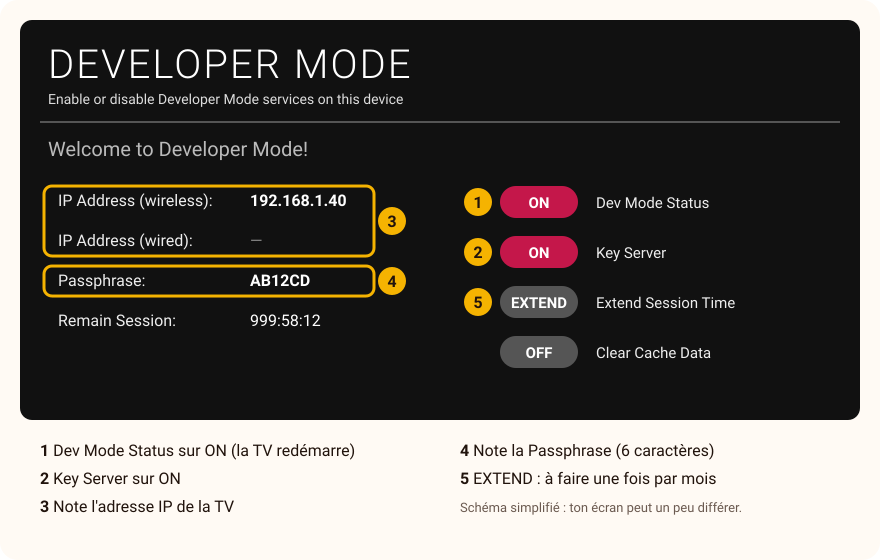

# Installer CroissantTV sur une TV LG

[← Retour à l'accueil](../README.md) · [Questions fréquentes](../FAQ.md)

**Compte environ 20 minutes la première fois**, puis 2 minutes à chaque nouvelle version.
Aucune connaissance technique n'est nécessaire : suis les étapes dans l'ordre, sans en sauter.

> [!NOTE]
> **Pourquoi faut-il un ordinateur ?** CroissantTV n'est pas encore dans le magasin d'applications de LG.
> Pour installer une application en dehors du magasin, LG propose un réglage **officiel et gratuit**, le
> **mode développeur**. Il se pilote depuis un ordinateur : c'est l'ordinateur qui envoie l'application
> vers la TV. Une fois installée, CroissantTV s'utilise ensuite à la télécommande, sans ordinateur.

## Ce qu'il te faut

- Une **TV LG de 2020 ou plus récente**, connectée à Internet.
- Un **ordinateur** Windows 10 ou 11, ou un Mac, connecté **à la même box** que la TV (même Wi-Fi ou câble de la même box).
- Une **adresse e-mail**, pour créer un compte développeur LG (gratuit).
- Le **kit LG**, à télécharger sur l'ordinateur : **[CroissantTV-Kit-LG.zip](https://github.com/thomasjanet60-spec/CroissantTV-beta/releases/latest/download/CroissantTV-Kit-LG.zip)**

> [!TIP]
> Garde la télécommande de la TV à portée de main, et installe-toi si possible avec l'ordinateur près de la TV :
> tu vas passer de l'un à l'autre.

---

## Étape 1 — Ouvrir le kit sur l'ordinateur

1. Ouvre le dossier **Téléchargements** de l'ordinateur.
2. Ouvre le kit :
   - **Windows :** fais un clic droit sur **CroissantTV-Kit-LG.zip**, choisis **Extraire tout…**, puis clique sur **Extraire** ;
   - **Mac :** double-clique sur **CroissantTV-Kit-LG.zip**.
3. Un dossier **CroissantTV-Kit-LG** s'ouvre. Il contient :
   - `1-LISEZ-MOI.txt`
   - `2-Guide-installation-LG.pdf` : ce guide, à garder ouvert ;
   - `3-CroissantTV-LG.ipk` : l'application CroissantTV ;
   - le dossier `Outils-ordinateur` : le logiciel **webOS Dev Manager**, qui envoie l'application vers la TV.

## Étape 2 — Créer ton compte développeur LG (gratuit)

Ce compte sert uniquement à activer le mode développeur sur ta TV. Il ne coûte rien et ne t'engage à rien.

1. Sur l'ordinateur, va sur **[webostv.developer.lge.com](https://webostv.developer.lge.com)** (le site est en anglais).
2. Clique sur **Sign In** (« se connecter »), en haut à droite.
3. Choisis de **créer un compte** (*Create Account*) et laisse-toi guider : adresse e-mail, mot de passe, acceptation des conditions.
4. Ouvre l'e-mail que LG t'envoie et clique sur le lien de confirmation.
5. Note ton **e-mail** et ton **mot de passe** : tu vas les taper sur la TV à l'étape suivante.

> [!TIP]
> Tu as déjà un compte LG (par exemple pour LG ThinQ) ? Essaie d'abord de te connecter avec lui sur
> webostv.developer.lge.com. S'il est refusé, crée un compte comme ci-dessus.

## Étape 3 — Activer le mode développeur sur la TV

1. Sur la TV, appuie sur la touche <kbd>Accueil</kbd> (la maison) de la télécommande.
2. Ouvre le magasin d'applications de LG (**LG Content Store** ou **Applis**, selon les modèles).
3. Avec la loupe, cherche **Developer Mode** et installe cette application (elle est éditée par LG).
4. Ouvre **Developer Mode** et connecte-toi avec l'e-mail et le mot de passe de l'étape 2.
5. Mets **Dev Mode Status** sur **ON**. La TV demande à redémarrer : accepte, et attends qu'elle se rallume.
6. Rouvre l'application **Developer Mode** (elle est maintenant dans la liste de tes applications).
7. Mets **Key Server** sur **ON**.
8. **Laisse cet écran affiché.** Tu y lis deux informations dont tu vas avoir besoin :
   - l'**adresse IP** de la TV (*IP Address*), quatre nombres séparés par des points, par exemple `192.168.1.40` ;
   - la **Passphrase**, un code de 6 caractères. Attention aux majuscules et aux minuscules.

## Étape 4 — Installer webOS Dev Manager sur l'ordinateur

webOS Dev Manager est un logiciel libre et gratuit, très utilisé pour installer des applications sur les TV LG.
Il est fourni dans le kit.

**Windows :**

1. Dans le dossier du kit, ouvre `Outils-ordinateur`, puis double-clique sur **Windows-webOS-Dev-Manager.msi**.
2. Si Windows affiche **« Windows a protégé votre ordinateur »** : clique sur **Informations complémentaires**, puis sur **Exécuter quand même**.
3. Suis l'installation : **Next** (suivant), puis **Install** (installer), puis **Finish** (terminer). Windows peut demander « Voulez-vous autoriser cette application à apporter des modifications ? » : réponds **Oui**.
4. Lance **webOS Dev Manager** depuis le menu Démarrer.

**Mac :**

1. Dans le dossier du kit, ouvre `Outils-ordinateur`, puis double-clique sur **Mac-webOS-Dev-Manager.dmg**.
2. Glisse l'icône **webOS Dev Manager** dans le dossier **Applications**.
3. Ouvre-le depuis le dossier **Applications**. Si le Mac refuse de l'ouvrir, va dans **Réglages Système › Confidentialité et sécurité**, descends jusqu'au message qui parle de webOS Dev Manager et clique sur **Ouvrir quand même**.

## Étape 5 — Relier l'ordinateur à la TV

Au premier lancement, webOS Dev Manager ouvre un assistant en anglais. Voici quoi répondre :

1. **Connection Mode** (mode de connexion) : choisis **Use Developer Mode**, puis **Next**.
2. **Setup Developer Mode** : c'est le rappel de l'étape 3, déjà faite. Clique sur **Next** (ou **Skip**).
3. **Setup Device** (ta TV) :
   - **Device Name** : un nom au choix, par exemple `Salon` ;
   - **Address** : l'**adresse IP** affichée par l'application Developer Mode de la TV ;
   - laisse le **port** (`9922`) et l'**Username** comme ils sont ;
   - **Authentication** : choisis **Dev Mode**, puis tape la **Passphrase** affichée sur la TV.
4. Clique sur **Finish**. Ta TV apparaît dans webOS Dev Manager.

> [!WARNING]
> **Ça ne se connecte pas ?** Vérifie dans cet ordre :
> 1. **Key Server** est bien sur **ON** dans l'application Developer Mode de la TV (il se remet sur OFF à chaque redémarrage de la TV) ;
> 2. l'adresse IP tapée est exactement celle de la TV ;
> 3. l'ordinateur et la TV sont sur la **même box** (pas de réseau « invité », pas de répéteur séparé) ;
> 4. aucun **VPN** n'est allumé sur l'ordinateur.

## Étape 6 — Installer CroissantTV

1. Dans webOS Dev Manager, clique sur l'icône **Apps** dans la barre de gauche (survole les icônes : leur nom s'affiche).
2. Clique sur le bouton bleu **Install**, en haut à droite.
3. Choisis le fichier **3-CroissantTV-LG.ipk** dans le dossier du kit, puis **Ouvrir**.
4. Attends la fin de la barre de progression (quelques secondes à une minute).
5. Sur la TV, appuie sur <kbd>Accueil</kbd> : **CroissantTV** est dans la liste des applications (souvent tout au bout). Ouvre-la.

Au premier lancement, CroissantTV te guide : il te demande ton abonnement IPTV, ou te propose la **démo** pour découvrir l'application sans abonnement.

> [!TIP]
> Pour retrouver CroissantTV plus vite, déplace sa tuile au début de la liste : sélectionne-la, maintiens
> la touche <kbd>OK</kbd> enfoncée, puis déplace-la avec les flèches.

---

## Important : garder le mode développeur actif

Le mode développeur de LG dure **1 000 heures (environ 40 jours)**, puis il faut le prolonger.
S'il expire, **la TV retire CroissantTV au redémarrage suivant** (tes réglages sont alors perdus sur cette TV).

- **Pour le prolonger :** ouvre l'application **Developer Mode** sur la TV et appuie sur **EXTEND**. Le compteur *Remain Session* repart pour 1 000 heures. Le plus simple : le faire **une fois par mois**.
- **Depuis l'ordinateur :** webOS Dev Manager, icône **Info**, bouton **Renew session**. Le compteur affiché sur la TV ne se met à jour qu'au redémarrage suivant de la TV.
- Le mode développeur se coupe aussi si la TV redémarre **dix fois sans être connectée à Internet**.
- Une **mise à jour du système de la TV** peut le désactiver. Si CroissantTV a disparu après une mise à jour, rouvre Developer Mode, réactive **Dev Mode Status**, puis réinstalle CroissantTV (étape 6).

> [!CAUTION]
> Une fois le compteur arrivé à zéro, on ne peut plus prolonger : il faut se reconnecter dans l'application
> Developer Mode, réactiver le mode développeur et réinstaller CroissantTV. Pense à prolonger avant !

## Mettre à jour CroissantTV

Quand une nouvelle version est annoncée :

1. Télécharge le nouveau kit (même lien : **[CroissantTV-Kit-LG.zip](https://github.com/thomasjanet60-spec/CroissantTV-beta/releases/latest/download/CroissantTV-Kit-LG.zip)**) et extrais-le (étape 1), ou télécharge seulement l'application : **[CroissantTV-LG.ipk](https://github.com/thomasjanet60-spec/CroissantTV-beta/releases/latest/download/CroissantTV-LG.ipk)**.
2. Sur la TV, ouvre **Developer Mode** et remets **Key Server** sur **ON**.
3. Dans webOS Dev Manager : **Apps**, **Install**, choisis le nouveau fichier `.ipk`.

Pas besoin de désinstaller l'ancienne version : **tes sources, profils et réglages sont conservés.**

## Désinstaller CroissantTV

Sur la TV, comme n'importe quelle application : touche <kbd>Accueil</kbd>, sélectionne la tuile CroissantTV,
maintiens <kbd>OK</kbd> enfoncé puis choisis la corbeille (ou **Supprimer**). Tu peux aussi le faire depuis
webOS Dev Manager, onglet **Apps**, liste **Installed**.

Si tu ne comptes plus installer d'application, tu peux ensuite couper le mode développeur dans l'application
Developer Mode (**Dev Mode Status** sur **OFF**).

## En cas de souci

| Ce que tu vois | Ce qu'il faut faire |
|---|---|
| L'application **Developer Mode** est introuvable dans le magasin | Vérifie que la TV est connectée à Internet et que les **contrats d'utilisation** de LG sont acceptés dans les paramètres de la TV (sans eux, le magasin n'affiche presque rien). |
| La connexion dans Developer Mode échoue | Retape l'e-mail et le mot de passe du compte créé à l'étape 2. Vérifie que tu as bien cliqué sur le lien de confirmation reçu par e-mail. |
| webOS Dev Manager ne trouve pas la TV | Voir l'encadré « Ça ne se connecte pas ? » de l'étape 5. Redémarre la TV, rouvre Developer Mode et remets **Key Server** sur **ON**. |
| « Wrong passphrase » | La passphrase a peut-être changé : relis-la sur la TV et retape-la (majuscules comprises). |
| L'installation échoue | Redémarre la TV, remets **Key Server** sur **ON**, puis recommence l'étape 6. |
| CroissantTV a disparu de la TV | Le mode développeur a expiré ou a été coupé par une mise à jour : voir « Garder le mode développeur actif ». |

Toujours bloqué ? Écris-nous à **support@croissanttv.fr** en décrivant l'étape où tu t'arrêtes ; une photo de
l'écran aide beaucoup. D'autres réponses dans les **[questions fréquentes](../FAQ.md)**.
