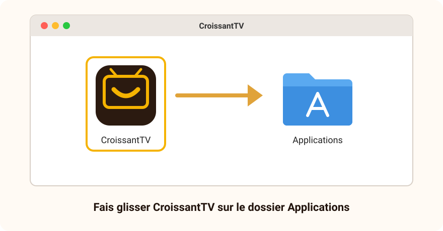
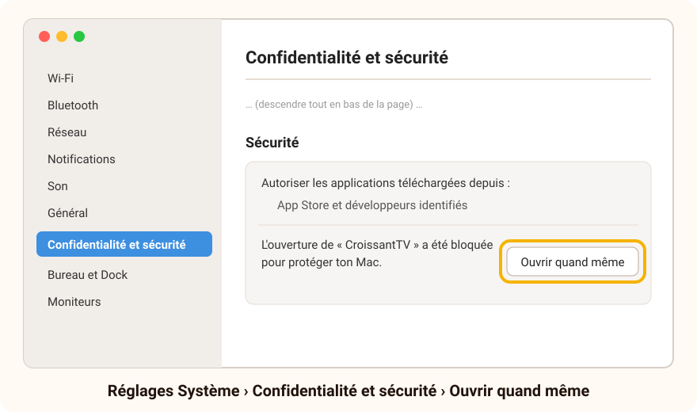

# Installer CroissantTV sur un Mac

[← Retour à l'accueil](../README.md) · [Questions fréquentes](../FAQ.md)

**Compte 5 minutes.** Il faut un Mac sous **macOS 14 Sonoma ou plus récent**, avec une puce Apple (M1, M2, M3, M4…) ou un processeur Intel.

> [!NOTE]
> **Pourquoi le Mac affiche-t-il un avertissement ?** Pendant la bêta, CroissantTV n'est pas encore
> « signé » par un certificat Apple payant ni vérifié par Apple. À la première ouverture, le Mac le bloque
> donc par précaution : il faut lui dire une fois que tu lui fais confiance (étape 3). C'est normal tant
> que tu télécharges CroissantTV **depuis cette page et nulle part ailleurs**.

---

## Étape 1 — Télécharger

Télécharge l'un des deux, au choix :

- **[CroissantTV-macOS.dmg](https://github.com/thomasjanet60-spec/CroissantTV-beta/releases/latest/download/CroissantTV-macOS.dmg)** : l'application seule (environ 25 Mo) ;
- **[CroissantTV-Kit-Mac.zip](https://github.com/thomasjanet60-spec/CroissantTV-beta/releases/latest/download/CroissantTV-Kit-Mac.zip)** : l'application et ce guide en PDF. Double-clique dessus : un dossier **CroissantTV-Kit-Mac** s'ouvre, l'application y porte le nom `3-CroissantTV-macOS.dmg`.

Le fichier arrive dans le dossier **Téléchargements**.

## Étape 2 — Installer

1. Double-clique sur **CroissantTV-macOS.dmg**. Une fenêtre s'ouvre avec deux icônes : **CroissantTV** et
   le dossier **Applications**.
2. **Fais glisser CroissantTV sur le dossier Applications**, puis lâche-le. La copie prend quelques secondes.

   

3. Ferme cette fenêtre, puis éjecte le disque **CroissantTV** : dans la barre latérale du Finder, clique sur
   le petit triangle **⏏** à côté de son nom. Le fichier `.dmg` peut ensuite aller à la corbeille.

## Étape 3 — Ouvrir CroissantTV la première fois

1. Ouvre le dossier **Applications** (dans le Finder, ou avec <kbd>⇧</kbd> <kbd>⌘</kbd> <kbd>A</kbd>), puis
   double-clique sur **CroissantTV**.
2. Le Mac refuse de l'ouvrir et affiche un message :
   - **macOS 15 et plus récent :** « Apple n'a pas pu confirmer que “CroissantTV” ne contenait pas de
     logiciel malveillant… ». Clique sur **Terminé** ;
   - **macOS 14 :** « “CroissantTV” ne peut pas être ouvert, car Apple ne peut pas vérifier s'il contient
     des logiciels malveillants ». Clique sur **OK**.

   Ne clique **pas** sur « Placer dans la corbeille ».
3. Ouvre le menu **Apple** (la pomme, en haut à gauche de l'écran), puis **Réglages Système…**
4. Dans la colonne de gauche, choisis **Confidentialité et sécurité**, puis descends tout en bas de la page,
   jusqu'à la rubrique **Sécurité**.
5. Un message dit que l'ouverture de « CroissantTV » a été bloquée. Clique sur **Ouvrir quand même**.

   

6. Le Mac demande ton mot de passe (ou ton empreinte) : c'est celui qui sert à ouvrir ta session.
7. Une dernière fenêtre s'affiche : clique sur **Ouvrir quand même**. CroissantTV démarre.

> [!TIP]
> **Sur macOS 14 Sonoma**, il existe un raccourci : dans **Applications**, fais un clic droit (ou
> <kbd>ctrl</kbd> + clic) sur **CroissantTV**, choisis **Ouvrir**, puis **Ouvrir** dans la fenêtre qui s'affiche.

**Mac à puce Apple :** à la toute première ouverture, le Mac peut proposer d'**installer Rosetta**. Clique sur
**Installer** et accepte : c'est un composant d'Apple, gratuit, dont CroissantTV a besoin pendant la bêta. Il
faut être connecté à Internet. Cela ne se fait qu'une fois.

Tout cela ne se fait **qu'une fois**. Ensuite, CroissantTV s'ouvre comme n'importe quelle application : depuis
**Applications**, le **Launchpad** ou **Spotlight** (<kbd>⌘</kbd> <kbd>espace</kbd>, puis tape `CroissantTV`).
Pour le garder dans le Dock : clic droit sur son icône pendant qu'il est ouvert, **Options › Garder dans le Dock**.

Au premier lancement, CroissantTV te guide : il te demande ton abonnement IPTV, ou te propose la **démo** pour
découvrir l'application sans abonnement. Il te propose ensuite de régler l'affichage, la langue et le démarrage
en quelques questions : voir **[Premiers pas](Premiers-pas.md)**.

## Utiliser CroissantTV au clavier, à la souris et au trackpad

CroissantTV a été pensé pour la télécommande ; sur Mac, le clavier la remplace :

| Télécommande | Clavier du Mac |
|---|---|
| Flèches | <kbd>←</kbd> <kbd>↑</kbd> <kbd>→</kbd> <kbd>↓</kbd> |
| OK | <kbd>↩</kbd> (Entrée) |
| Retour | <kbd>esc</kbd> (Échap) ou <kbd>⌫</kbd> (effacement) |
| Touches rouge, verte, jaune | <kbd>F1</kbd>, <kbd>F2</kbd>, <kbd>F3</kbd> (sur la plupart des claviers Mac, en maintenant <kbd>fn</kbd>) |
| Plein écran | la lettre <kbd>F</kbd>, ou double-clic sur l'image |
| Quitter CroissantTV | <kbd>⌘</kbd> <kbd>Q</kbd> |

La souris et le trackpad marchent aussi : un clic pour choisir, deux doigts pour faire défiler les listes.

Avec le Premium, les **enregistrements** de chaînes vont dans ton dossier **Films**, sous-dossier
**CroissantTV**.

---

## Mettre à jour CroissantTV

Quand une nouvelle version est annoncée, télécharge le nouveau fichier `.dmg` (même lien), quitte CroissantTV
(<kbd>⌘</kbd> <kbd>Q</kbd>), puis refais l'**étape 2** : fais glisser CroissantTV sur **Applications** et choisis
**Remplacer**. **Tes sources, profils et réglages sont conservés.** Si le Mac bloque de nouveau l'ouverture,
refais l'**étape 3**.

## Désinstaller CroissantTV

1. Quitte CroissantTV (<kbd>⌘</kbd> <kbd>Q</kbd>).
2. Dans le Finder, ouvre **Applications** et fais glisser **CroissantTV** sur la **Corbeille** du Dock.

> [!NOTE]
> Sur Mac, la désinstallation **laisse en place** tes sources, profils et réglages : tu les retrouves si tu
> réinstalles CroissantTV. Pour les effacer aussi : dans le Finder, menu **Aller › Aller au dossier…**, tape
> `~/Library/WebKit/com.croissanttv.app` et appuie sur <kbd>↩</kbd>, puis mets ce dossier à la corbeille ;
> fais de même avec `~/Library/Application Support/CroissantTV`. Tes enregistrements restent dans
> **Films › CroissantTV** tant que tu ne les supprimes pas.

## En cas de souci

| Ce que tu vois | Ce qu'il faut faire |
|---|---|
| Pas de bouton **Ouvrir quand même** dans **Confidentialité et sécurité** | Il n'apparaît qu'**après** une tentative d'ouverture, et pendant environ une heure. Refais le point 1 de l'étape 3, puis retourne dans les Réglages. |
| « “CroissantTV” est endommagé et ne peut pas être ouvert » | Mets le fichier téléchargé à la corbeille et télécharge-le de nouveau **depuis cette page**. Si le message revient, écris-nous avec ta version de macOS. |
| « Vous ne pouvez pas utiliser cette version de l'application avec cette version de macOS » | CroissantTV demande **macOS 14 Sonoma** ou plus récent. Ta version est dans le menu **Apple › À propos de ce Mac**. |
| Le Mac propose Rosetta, mais l'installation échoue | Vérifie la connexion à Internet, puis rouvre CroissantTV : la proposition revient. |
| Une fenêtre « La lecture vidéo ne sera pas disponible » | Le moteur vidéo n'a pas pu démarrer. Note le message exact et écris-nous : le reste de l'application (réglages, catalogue, guide) fonctionne quand même. |

Toujours bloqué ? Écris-nous à **support@croissanttv.fr** en indiquant ton modèle de Mac, ta version de macOS
et l'étape où tu t'arrêtes ; une capture d'écran aide beaucoup (<kbd>⇧</kbd> <kbd>⌘</kbd> <kbd>5</kbd>).
D'autres réponses dans les **[questions fréquentes](../FAQ.md)**.
