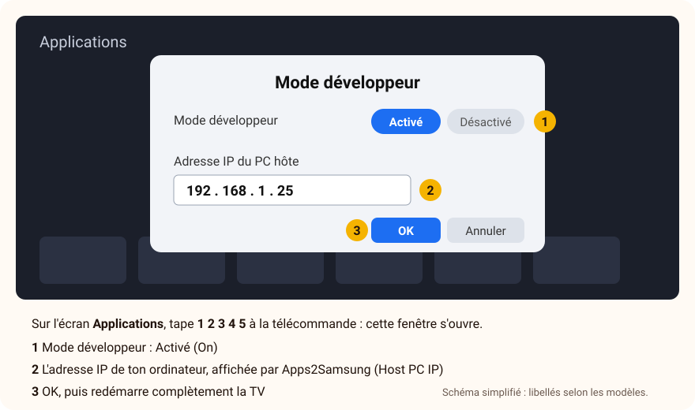

# Installer CroissantTV sur une TV Samsung

[← Retour à l'accueil](../README.md) · [Questions fréquentes](../FAQ.md)

**Compte environ 20 minutes la première fois**, puis 2 minutes à chaque nouvelle version.
Aucune connaissance technique n'est nécessaire : suis les étapes dans l'ordre, sans en sauter.

> [!IMPORTANT]
> **La version Samsung est la plus récente de la bêta, et la moins testée.** Tes retours sont particulièrement
> précieux : dis-nous ce qui marche et ce qui ne marche pas, en précisant le modèle de ta TV.

> [!NOTE]
> **Pourquoi faut-il un ordinateur ?** CroissantTV n'est pas encore dans le magasin d'applications de Samsung.
> Pour installer une application en dehors du magasin, Samsung propose un réglage **officiel**, le
> **mode développeur**, piloté depuis un ordinateur. Un logiciel gratuit, **Apps2Samsung**, s'occupe de
> tout le côté technique : il prépare l'application pour ta TV et l'y envoie.

## Ce qu'il te faut

- Une **TV Samsung de 2019 ou plus récente** (système Tizen), connectée à Internet.
- Un **ordinateur** Windows 10 ou 11, ou un Mac, connecté **à la même box** que la TV (même Wi-Fi ou câble de la même box).
- Un **compte Samsung** (gratuit). Tu en as déjà un si tu utilises un téléphone Samsung ou l'application SmartThings ; sinon, tu le créeras pendant l'installation.
- Le **kit Samsung**, à télécharger sur l'ordinateur : **[CroissantTV-Kit-Samsung.zip](https://github.com/thomasjanet60-spec/CroissantTV-beta/releases/latest/download/CroissantTV-Kit-Samsung.zip)**

> [!TIP]
> Garde la télécommande de la TV à portée de main : tu vas passer de l'ordinateur à la TV.

---

## Étape 1 — Ouvrir le kit sur l'ordinateur

1. Ouvre le dossier **Téléchargements** de l'ordinateur.
2. Ouvre le kit :
   - **Windows :** fais un clic droit sur **CroissantTV-Kit-Samsung.zip**, choisis **Extraire tout…**, puis clique sur **Extraire** ;
   - **Mac :** double-clique sur **CroissantTV-Kit-Samsung.zip**.
3. Un dossier **CroissantTV-Kit-Samsung** s'ouvre. Il contient :
   - `1-LISEZ-MOI.txt`
   - `2-Guide-installation-Samsung.pdf` : ce guide, à garder ouvert ;
   - `3-CroissantTV-Samsung.wgt` : l'application CroissantTV.

## Étape 2 — Installer Apps2Samsung sur l'ordinateur

Apps2Samsung est un logiciel libre et gratuit qui installe des applications sur les TV Samsung. Il change
très souvent pour suivre les nouvelles TV : c'est pourquoi on le télécharge directement chez lui, toujours
dans sa dernière version.

1. Va sur **[apps2samsung.com](https://apps2samsung.com)** et clique sur le bouton de téléchargement correspondant à ton ordinateur.
   (Tous les fichiers sont aussi sur [la page de ses versions](https://github.com/Apps2Samsung/Apps2Samsung/releases/latest) : pour Windows, celui qui finit par **`-win-x64.zip`** ; pour un Mac récent, **`-macos-arm64.dmg`**, pour un Mac plus ancien à processeur Intel, **`-macos-x64.dmg`**.)
2. Installe-le :
   - **Windows :** fais un clic droit sur le fichier téléchargé, **Extraire tout…**, **Extraire**, puis double-clique sur **Apps2Samsung** dans le dossier obtenu. Si Windows affiche **« Windows a protégé votre ordinateur »** : **Informations complémentaires**, puis **Exécuter quand même**.
   - **Mac :** ouvre le fichier `.dmg`, glisse **Apps2Samsung** dans **Applications**, puis ouvre-le. Si le Mac refuse : **Réglages Système › Confidentialité et sécurité › Ouvrir quand même**.
3. Apps2Samsung s'ouvre et cherche les TV Samsung de ton réseau. Laisse-le ouvert.

> [!NOTE]
> Apps2Samsung est en anglais et son apparence change d'une version à l'autre. Les noms de boutons de ce
> guide sont ceux de sa version 3 ; s'ils ont un peu changé, cherche le bouton qui a le même sens.

## Étape 3 — Activer le mode développeur sur la TV

Apps2Samsung affiche **l'adresse IP de ton ordinateur** (*Local IP*, ou dans son guide *Enter this IP address*) :
quatre nombres séparés par des points, par exemple `192.168.1.25`. Note-la, puis sur la TV :

1. Appuie sur la touche <kbd>Accueil</kbd> (la maison) de la télécommande, puis ouvre **Applications** (*Apps*).
2. Sur l'écran des applications, tape **1 2 3 4 5** :
   - avec les touches chiffres de la télécommande ;
   - sur une télécommande sans chiffres (télécommande « Smart »), appuie sur la touche <kbd>123</kbd> pour afficher un pavé de chiffres à l'écran.
3. Une fenêtre **Mode développeur** (*Developer mode*) s'ouvre. Mets-le sur **Activé** (*On*).
4. Dans **Adresse IP de l'hôte** (*Host PC IP*), tape l'adresse IP de ton ordinateur, puis **OK**.
5. **Redémarre complètement la TV :** maintiens la touche <kbd>Marche</kbd> de la télécommande enfoncée jusqu'à ce que le logo Samsung apparaisse. Si rien ne se passe, débranche la TV de la prise pendant 30 secondes, puis rebranche-la.

> [!WARNING]
> Rien ne se passe quand tu tapes 1 2 3 4 5 ? Vérifie que tu es bien **sur l'écran des applications** (pas
> sur l'accueil), puis tape les cinq chiffres à la suite, sans t'arrêter.

## Étape 4 — Retrouver la TV dans Apps2Samsung

1. Une fois la TV rallumée, reviens sur l'ordinateur et clique sur **Rescan for TVs** (chercher de nouveau les TV).
2. Ta TV apparaît : sélectionne-la.
3. Si elle n'apparaît pas :
   - vérifie que la TV est allumée et sur la **même box** que l'ordinateur ;
   - coupe tout **VPN** sur l'ordinateur ;
   - utilise **Add TV by IP…** (ajouter une TV par son adresse) et tape l'adresse IP de la TV. Elle se lit sur la TV dans **Paramètres › Général › Réseau › État du réseau › Paramètres IP** (les noms varient un peu selon les années).

Si Apps2Samsung dit que la TV est trouvée mais que le mode développeur n'est pas prêt, il t'indique quoi refaire :
le plus souvent, retaper l'adresse IP dans la fenêtre Mode développeur, puis redémarrer complètement la TV.

## Étape 5 — Installer CroissantTV

1. Dans Apps2Samsung, clique sur **Install a file…** (installer un fichier).
2. Choisis le fichier **3-CroissantTV-Samsung.wgt** dans le dossier du kit, puis **Ouvrir**.
3. **La première fois**, Apps2Samsung te demande de te connecter à ton compte Samsung (*Sign in with Samsung*) :
   une page Samsung s'ouvre dans ton navigateur. Connecte-toi (ou crée ton compte), puis reviens dans Apps2Samsung.
   Il fabrique alors un **certificat** : une autorisation d'installation, propre à ta TV, que Samsung exige.
   Il la garde pour les prochaines fois.
4. Attends la fin de l'installation : Apps2Samsung affiche **« CroissantTV has been successfully installed! »** (installé avec succès).
5. Sur la TV : touche <kbd>Accueil</kbd>, **Applications** : CroissantTV y est. Ouvre-la.

Au premier lancement, CroissantTV te guide : il te demande ton abonnement IPTV, ou te propose la **démo** pour découvrir l'application sans abonnement.

> [!TIP]
> Pour l'avoir sous la main, ajoute CroissantTV à l'accueil : dans **Applications**, sélectionne sa tuile,
> appuie longuement sur la touche centrale et choisis **Ajouter à l'accueil** (selon les modèles).

---

## Mettre à jour CroissantTV

Quand une nouvelle version est annoncée :

1. Télécharge le nouveau kit (même lien : **[CroissantTV-Kit-Samsung.zip](https://github.com/thomasjanet60-spec/CroissantTV-beta/releases/latest/download/CroissantTV-Kit-Samsung.zip)**) et extrais-le, ou télécharge seulement l'application : **[CroissantTV-Samsung.wgt](https://github.com/thomasjanet60-spec/CroissantTV-beta/releases/latest/download/CroissantTV-Samsung.wgt)**.
2. Ouvre **Apps2Samsung** sur le **même ordinateur** que la première fois, et sélectionne ta TV.
3. **Install a file…**, choisis le nouveau fichier `.wgt`.

**Tes sources, profils et réglages sont conservés.** Apps2Samsung réutilise l'autorisation fabriquée la première
fois : garde-le sur ce même ordinateur.

> [!CAUTION]
> Samsung n'accepte une mise à jour que si elle est signée avec **la même autorisation** que la première
> installation. Si tu changes d'ordinateur, sauvegarde d'abord les réglages et certificats d'Apps2Samsung
> (dans ses paramètres, sauvegarde *Backup*) pour les restaurer sur le nouvel ordinateur. Sinon, Samsung
> refusera la mise à jour et il faudra désinstaller CroissantTV avant de le réinstaller (tes réglages seraient
> alors perdus).

## Désinstaller CroissantTV

Sur la TV : touche <kbd>Accueil</kbd>, **Applications**, sélectionne CroissantTV, ouvre ses options
(appui long sur la touche centrale, ou l'icône des réglages des applications) puis **Supprimer**.

Si tu n'installes plus rien depuis l'ordinateur, tu peux couper le mode développeur : sur l'écran des
applications, tape de nouveau **1 2 3 4 5** et mets-le sur **Désactivé**.

## En cas de souci

| Ce que tu vois | Ce qu'il faut faire |
|---|---|
| Apps2Samsung ne trouve pas la TV | TV allumée, même box, pas de VPN ; puis **Add TV by IP…** avec l'adresse de la TV (étape 4). |
| La TV est trouvée, mais « Developer Mode is off » ou « IP doesn't match » | Retape l'adresse IP **de l'ordinateur** dans la fenêtre Mode développeur de la TV (étape 3), puis redémarre complètement la TV. |
| La fenêtre Mode développeur a enregistré l'adresse à l'envers (par exemple `25.1.168.192`) | C'est un défaut connu de certaines TV : Apps2Samsung te le signale. Retape l'adresse **à l'envers** dans la TV pour qu'elle s'affiche dans le bon ordre. |
| « Author certificate mismatch » ou « signed with a different certificate » | Une version de CroissantTV signée autrement est déjà sur la TV : supprime-la sur la TV, puis recommence l'étape 5. |
| « This app needs Tizen 5.0 or newer » | Ta TV est antérieure à 2019 : CroissantTV ne peut pas y fonctionner. |
| L'installation s'interrompt (« connection reset ») | Relance simplement l'installation ; si ça recommence, redémarre la TV. |
| Une erreur pendant la connexion au compte Samsung | Attends 15 minutes et réessaie : les serveurs limitent le nombre d'essais. |

Toujours bloqué ? Écris-nous à **support@croissanttv.fr** en indiquant le modèle de ta TV (étiquette au dos,
ou **Paramètres › Assistance › À propos de ce téléviseur**) et l'étape où tu t'arrêtes ; une photo de l'écran
aide beaucoup. D'autres réponses dans les **[questions fréquentes](../FAQ.md)**.
